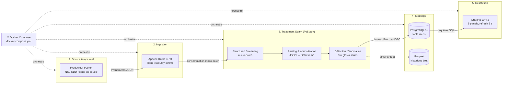
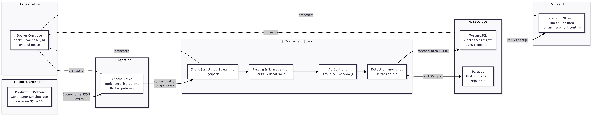
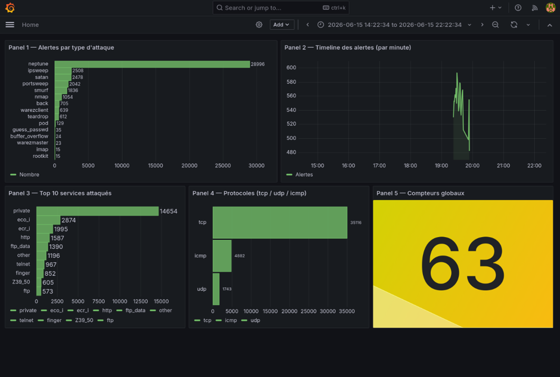

<div align="center">

#  Plateforme Big Data de Détection d'Anomalies de Sécurité en Temps Réel

**Kafka · Spark Structured Streaming · PostgreSQL · Grafana · Docker**


*Projet du module **Architecture et Technologies BigData** : Master Sécurité IT & BigData, FSTT (Université Abdelmalek Essaâdi), année 2025/2026*

</div>

---

##  Présentation

Ce projet met en place une plateforme **end-to-end** de traitement de flux en temps réel pour **détecter automatiquement des attaques réseau**. Le dataset académique **NSL-KDD** (125 000 connexions réseau étiquetées) est rejoué en continu pour simuler un trafic réel. Chaque événement traverse un pipeline complet : ingestion, traitement, stockage, puis visualisation.

La plateforme repose sur une **architecture Kappa** : un pipeline unique orienté streaming, sans couche batch séparée. Elle apporte simplicité d'exploitation, faible latence et cohérence du traitement. Toute la stack est **open-source** et **conteneurisée** : un seul `docker compose up` suffit à tout démarrer.

### Points clés

| | |
|---|---|
|  **Latence end-to-end** | < 2 secondes |
|  **Alertes détectées** | **39 198** réparties sur 22 labels |
|  **Familles couvertes** | DoS, Probe, R2L, U2R |
|  **Rejeu** | Boucle infinie du dataset (125 000 connexions) |
|  **Dashboard** | 5 panels Grafana, rafraîchissement toutes les 5 s |

---

##  Architecture & flux de données

### Vue d'ensemble





### Détail des étapes

| # | Composant | Version | Rôle |
|---|-----------|---------|------|
| 1 | **Producteur Python** | Python 3.11 | Lit `KDDTrain+.txt`, sérialise chaque connexion (41 caractéristiques + label) en JSON et la publie dans Kafka. Boucle infinie pour un flux continu. |
| 2 | **Apache Kafka** | 3.7.0 | Broker publish/subscribe. Topic `security-events` (1 partition). Garantit durabilité et rejouabilité. |
| 3 | **Spark Structured Streaming** | 3.5.1 | Consomme le topic en micro-batch, parse le JSON, applique les règles de détection, écrit les alertes via `foreachBatch` + JDBC. |
| 4 | **PostgreSQL** | 16 | Stocke les alertes dans la table `alerts` avec leurs métadonnées. |
| 5 | **Grafana** | 10.4.2 | Dashboard provisionné automatiquement (datasource + 5 panels), sans configuration manuelle. |

---

## 🔍 Règles de détection

Trois règles sont appliquées sur chaque micro-batch dans `stream_processor.py`. Une connexion qui valide **au moins une règle** génère une alerte.

| Règle | Condition | Signification |
|-------|-----------|---------------|
| **1. Label connu** | `label != "normal"` | Attaque déjà identifiée dans le dataset |
| **2. SYN Flood** | `flag == "S0"` | Paquet SYN envoyé sans réponse (DoS) |
| **3. Taux d'erreurs SYN** | `serror_rate > 0.5` | Plus de 50 % des connexions récentes échouent en phase SYN |

```python
alerts = batch_df.filter(
    (col('label') != 'normal') |   # Règle 1
    (col('flag') == 'S0') |        # Règle 2
    (col('serror_rate') > 0.5)     # Règle 3
)
```

---

## 📈 Résultats

Bilan des alertes stockées dans PostgreSQL après plusieurs cycles de rejeu du dataset :

### Performance du pipeline

| Métrique | Valeur |
|----------|--------|
| Débit d'ingestion (Kafka) | ~10 à 20 événements/s |
| Latence end-to-end | < 2 secondes |
| Taille du dataset rejoué | 125 000 connexions |
| Fréquence des micro-batchs Spark | ~1 batch/s |
| Rafraîchissement du dashboard | 5 secondes |
| **Total d'alertes en base** | **39 198** |

### Répartition par famille d'attaque

| Famille | Alertes | Part |
|---------|--------:|-----:|
| **DoS** | 30 354 | 77,4 % |
| **Probe** | 7 574 | 19,3 % |
| **R2L** | 684 | 1,7 % |
| **U2R** | 42 | 0,1 % |
| Normal (faux positifs des règles 2/3) | 544 | 1,4 % |

### Détail par type d'attaque

| Type d'attaque | Alertes | Famille | Description |
|----------------|--------:|:-------:|-------------|
| `neptune` | **27 271** | DoS | SYN flood : épuisement des connexions TCP |
| `ipsweep` | 2 338 | Probe | Scan d'IP, reconnaissance du réseau |
| `satan` | 2 328 | Probe | Scan multi-services (outil SATAN) |
| `portsweep` | 1 918 | Probe | Scan de ports |
| `smurf` | 1 733 | DoS | Amplification ICMP broadcast |
| `nmap` | 990 | Probe | Scan de ports avec Nmap |
| `back` | 655 | DoS | Attaque Apache back door |
| `warezclient` | 598 | R2L | Téléchargement de logiciels piratés |
| `teardrop` | 567 | DoS | Fragmentation IP malformée |
| `normal` | 544 | n/a | Trafic légitime capté par les règles 2/3 |
| `pod` | 123 | DoS | Ping of Death |
| `guess_passwd` | 32 | R2L | Attaque par dictionnaire |
| `buffer_overflow` | 24 | U2R | Dépassement de tampon |
| `warezmaster` | 22 | R2L | Serveur de logiciels piratés |
| `rootkit` | 15 | U2R | Installation de rootkit |
| `imap` | 14 | R2L | Exploitation du service IMAP |
| `multihop` | 7 | R2L | Rebond multi-hôtes |
| `phf` | 6 | R2L | Exploitation CGI phf |
| `land` | 5 | DoS | IP source = IP destination |
| `ftp_write` | 3 | R2L | Écriture anonyme FTP |
| `loadmodule` | 3 | U2R | Chargement de module noyau malveillant |
| `spy` | 2 | R2L | Espionnage réseau |

### Observations

- **`neptune` (SYN flood) domine** avec 27 271 détections, soit ~70 % des alertes : c'est le reflet de sa prévalence dans NSL-KDD.
- Les attaques **Probe** (ipsweep, satan, portsweep, nmap) forment la 2ᵉ catégorie, signe d'une forte activité de reconnaissance.
- La classe **`normal`** génère 544 alertes : les règles 2 et 3 peuvent matcher des connexions légitimes (flag `S0` ou `serror_rate > 0.5`). C'est une limite connue des règles à seuils fixes.

---

## 📊 Dashboard Grafana

Le dashboard est provisionné automatiquement au démarrage de Docker.

| Panel | Type | Contenu |
|-------|------|---------|
| 1 | Bar chart horizontal | Alertes par type d'attaque (top 15) |
| 2 | Time series | Timeline des alertes par minute (dernière heure) |
| 3 | Bar chart horizontal | Top 10 des services attaqués |
| 4 | Bar chart horizontal | Répartition des protocoles tcp / udp / icmp |
| 5 | Stat | Compteurs globaux (total d'alertes, types distincts, services touchés) |



---

## 📁 Structure du projet

```
Projet_BigData/
├── docker-compose.yml              # Orchestration des 5 services
├── producer/
│   ├── producer.py                 # Producteur Python (NSL-KDD → Kafka)
│   └── KDDTrain+.txt               # Dataset NSL-KDD
├── spark/
│   └── stream_processor.py         # Job Spark Structured Streaming
├── data/
│   └── init.sql                    # Initialisation de PostgreSQL
├── grafana/
│   ├── provisioning/
│   │   ├── datasources/postgres.yml
│   │   └── dashboards/dashboard.yml
│   └── dashboards/
│       └── security_dashboard.json # Dashboard 5 panels
└── docs/
    ├── Compte_Rendu_BigData_VF.pdf # Rapport complet
    └── FluxBigData.png             # Schéma du flux
```

---

##  Démarrage rapide

### Prérequis

- [Docker](https://docs.docker.com/get-docker/) et Docker Compose
- ~4 Go de RAM disponibles
- Ports libres : `9092` (Kafka), `5432` (PostgreSQL), `3000` (Grafana)

### Installation

```bash
# 1. Cloner le dépôt
git clone https://github.com/soulaimane-22/Projet_BigData.git
cd Projet_BigData

# 2. Télécharger le dataset (si absent du dépôt)
cd producer
wget https://raw.githubusercontent.com/defcom17/NSL_KDD/master/KDDTrain+.txt
cd ..

# 3. Lancer toute l'infrastructure
docker compose up -d
docker ps        # les 5 conteneurs doivent être "Up"

# 4. Créer le topic Kafka
docker exec kafka /opt/kafka/bin/kafka-topics.sh \
  --bootstrap-server localhost:9092 --create \
  --topic security-events --partitions 1 --replication-factor 1
```

### Accès

| Service | URL / Commande |
|---------|----------------|
| **Grafana** | http://localhost:3000 (identifiants par défaut : `admin` / `admin`) |
| **Logs du producteur** | `docker logs producer --tail 10` |
| **Logs de Spark** | `docker logs spark --tail 15` |
| **Alertes par type** | `docker exec postgres psql -U admin -d bigdata -c "SELECT label, COUNT(*) AS total FROM alerts GROUP BY label ORDER BY total DESC;"` |

### Arrêt

```bash
docker compose down
```

> ⚠️ **Après un redémarrage de Kafka**, supprimez le checkpoint Spark (`rm -rf /tmp/bigdata/`) pour éviter une `OffsetOutOfRangeException`.

---

##  Difficultés rencontrées & solutions

| Problème | Solution |
|----------|----------|
| **Java incompatible** (Fedora 44 livre Java 25/26, Spark exige 8/11/17) | Installation de Java 17 via SDKMAN |
| **Permissions Docker** (groupe `docker` non pris en compte) | `newgrp docker` ou reconnexion de session |
| **Erreurs de configuration Spark** | Packages passés via `--packages` de `spark-submit` ; `outputMode("append")` ; `persist()`/`unpersist()` dans `foreachBatch` |
| **`OffsetOutOfRangeException`** | Suppression du checkpoint avant chaque relance |
| **Panels pie/donut Grafana vides** | Conversion en bar charts horizontaux |
| **Producteur arrêté après un passage** | Boucle `while True` autour de la lecture du fichier |
| **Code non portable** (`localhost` codé en dur) | Variables d'environnement (`KAFKA_BOOTSTRAP_SERVERS`, `POSTGRES_HOST`) |
| **Sink Parquet éphémère** (`/tmp`) | Acceptable en contexte académique ; HDFS ou MinIO pour la production |

---

## 🔐 Note de sécurité

Les identifiants fournis (`admin` / `admin123` pour PostgreSQL, `admin` / `admin` pour Grafana) sont **destinés à un usage académique local uniquement**. Pour tout déploiement réel, externalisez-les dans un fichier `.env` non versionné et changez-les.

---

## 👥 Équipe

| Nom | 
|-----|
| **Achraf Ettanouti** |
| **Soulaimane Benayad** |
| **Anas Rabih Senhaji** |

**Encadrant :** Pr. Anouar Abdelhakim BOUDHIR
**Établissement :** Faculté des Sciences et Techniques de Tanger, Université Abdelmalek Essaâdi
**Formation :** Master Sécurité IT & BigData : Module Architecture et Technologies BigData

---

## 📚 Références

- [Apache Kafka Documentation](https://kafka.apache.org/documentation/)
- [Spark Structured Streaming Guide](https://spark.apache.org/docs/latest/structured-streaming-programming-guide.html)
- Tavallaee, M. et al. (2009). *A detailed analysis of the KDD CUP 99 data set*, dataset NSL-KDD
- [Grafana Documentation](https://grafana.com/docs/)
- [Docker Compose Reference](https://docs.docker.com/compose/)
- Jay Kreps, [*Questioning the Lambda Architecture*](https://www.oreilly.com/radar/questioning-the-lambda-architecture/) (2014)
